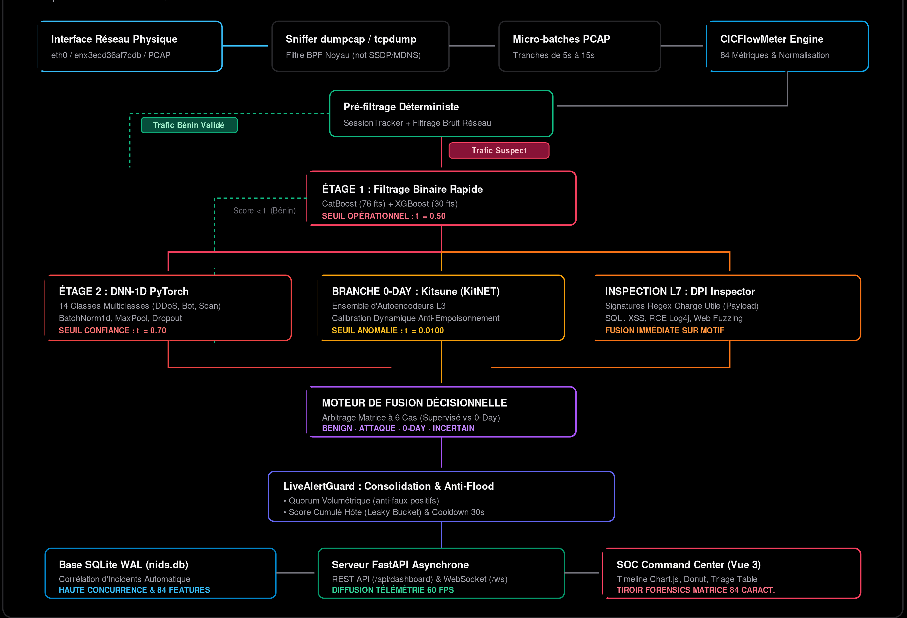

# Sentinel NIDS — Système de Détection d'Intrusions Multicouche & Dashboard SOC

[](https://www.python.org/)
[](https://pytorch.org/)
[](https://fastapi.tiangolo.com/)
[](https://vuejs.org/)
[](https://tailwindcss.com/)
[-brightgreen.svg)](#7-assurance-qualité--tests)
[](LICENSE)

**Sentinel NIDS** est une solution complète de cybersécurité pour la détection temps réel d'intrusions sur réseaux IP. Il associe un **pipeline de détection multicouche** (arbres de décision CatBoost/XGBoost, réseaux de neurones profonds 1D-DNN, autoencodeurs non-supervisés Kitsune pour les attaques *0-day* et inspection de contenu applicatif L7 DPI) à un **Centre de Commandement SOC d'entreprise** moderne (*Obsidian Dark*) propulsé par FastAPI, WebSockets et Vue 3.

---

## 1. Architecture Globale du Système



---

## 2. Piliers Technologiques & Modèles

| Rôle | Composant | Modèle / Moteur | Caractéristiques / Classes | Source |
|---|---|---|---|---|
| **Étage 1 (Principal)** | Filtrage binaire rapide | `CatBoostClassifier` (.cbm) | 76 caractéristiques CICIDS2017 | [HuggingFace](https://huggingface.co/pop123ux/pcap-ml-traffic-classifier) |
| **Étage 1 (Second avis)** | Confirmation de suspicion | `XGBoost` (.json) | 30 caractéristiques réduites | [GitHub csperera/aegis-ai](https://github.com/csperera/aegis-ai) |
| **Étage 2 (Multiclasse)** | Classification fine | `1D-DNN PyTorch` (.pth) | **14 classes d'attaques** CICIDS2017 | [HuggingFace](https://huggingface.co/saidimn/ids-cnn-cicids2017) |
| **Branche 0-Day** | Détection d'anomalies | `Kitsune KitNET` | Autoencodeurs incrémentaux sans étiquette | [GitHub ymirsky/Kitsune-py](https://github.com/ymirsky/Kitsune-py) |
| **Inspection L7** | Signatures applicatives | `DPI Inspector` | Regex SQLi, XSS, RCE Log4j, Fuzzing | Moteur interne optimisé |
| **Console SOC** | Dashboard temps réel | FastAPI + Vue 3 | WebSocket 60 FPS, SQLite WAL, Chart.js | Architecture modulaire |

### 14 Familles d'Attaques Reconnues par l'Étage 2 :
1. `DDoS`
2. `PortScan`
3. `Bot`
4. `Infiltration`
5. `Web Attack – Brute Force`
6. `Web Attack – XSS`
7. `Web Attack – SQL Injection`
8. `FTP-Patator`
9. `SSH-Patator`
10. `DoS slowloris`
11. `DoS Slowhttptest`
12. `DoS Hulk`
13. `DoS GoldenEye`
14. `Heartbleed`

---

## 3. Centre de Commandement SOC (Obsidian Dark)

Conçu selon les exigences des SOC d'élite (**CrowdStrike Falcon**, **Elastic Security**, **Linear**), le tableau de bord offre une ergonomie sans concession :
- **Top Status Bar** : Débit en direct (paquets/s, flux/s), interface active, seuils opérationnels $t_1, t_2, t_3$, mode Pause/Live et filtre loopback.
- **Bandeau de KPI** : Total flux analysés, attaques critiques, alertes 0-day, règles DPI déclenchées, taux de filtrage.
- **Chronologie de Trafic Réseau** : Double courbe lissée avec transition cubique (trafic normal en gris, pics d'attaques en rouge/ambre).
- **Ventilation par Moteur (Donut)** : Visualisation de la part respective de chaque moteur (DPI, DNN-1D, Kitsune, Filtrage Rapide).
- **Tableau de Triage Haute Densité** : Recherche plein texte, pagination, sévérité (`CRITICAL`, `HIGH`, `MEDIUM`, `LOW`, `BENIGN`).
- **Tiroir Médico-Légal (Forensics Drawer)** : Quintuplet réseau, décomposition des scores ML, débits formatés et **matrice intégrale des 84 caractéristiques CICFlowMeter** avec filtre de recherche interactif.

---

## 4. Installation et Démarrage Rapide

### Pré-requis
- Système d'exploitation : Linux (recommandé), macOS, Windows.
- Python 3.10+ (testé et validé sous Python 3.12).
- Node.js 18+ (pour la compilation du frontend Vue 3).
- Outils de capture : `dumpcap` ou `tcpdump`.

### Installation
```bash
# 1. Cloner le dépôt et initialiser l'environnement virtuel
git clone https://github.com/hoby/NIDS_pt.git
cd NIDS_pt
python3 -m venv .venv
source .venv/bin/activate

# 2. Installer les dépendances Python (CPU-optimisées)
pip install -r envs/main.txt
pip install -e .

# 3. Compiler le bundle frontend SOC
cd dashboard/frontend
npm install
npm run build
cd ../..
```

---

## 5. Guide d'Utilisation du CLI Unifié (`main.py`)

Le script `main.py` constitue le point d'entrée unique et centralisé :

### 5.1 Capture Réseau en Direct + Dashboard SOC Couplé
```bash
# Capture sur l'interface physique (ex: enx3ecd36af7cdb) par tranches de 5 secondes :
python main.py -i enx3ecd36af7cdb -b 5 --dashboard
```
*Accès direct au Dashboard Web : [http://localhost:8000](http://localhost:8000)*

### 5.2 Lancement Exclusif du Dashboard SOC (Mode Consultation)
```bash
python main.py --dashboard-only --host 0.0.0.0 --port 8000
```

### 5.3 Analyse d'un Fichier PCAP Hors-Ligne avec Dashboard
```bash
python main.py --pcap pcap/demo_nmap.pcap --dashboard --allow-loopback
```

### 5.4 Démonstration CLI Standalone
```bash
python scripts/run_demo.py data/samples/mini.csv --packets data/samples/packet_scores.parquet
```

---

## 6. Table de Décision de Fusion

| Étage 1 ($t_1 = 0.50$) | Étage 2 ($t_2 = 0.70$) | Kitsune ($t_3 = 0.0100$) | DPI Signature | Décision Finale | Sévérité SOC |
|:---:|:---:|:---:|:---:|:---:|:---:|
| Normal (< $t_1$) | *Non exécuté* | Normal (< $t_3$) | Aucune | `BENIGN` | `BENIGN` |
| Normal (< $t_1$) | *Non exécuté* | Anormal ($\ge t_3$) | Aucune | `ANOMALY_UNKNOWN` (0-Day) | `HIGH` |
| Suspect ($\ge t_1$) | Confiant ($\ge t_2$) | Indifférent | Indifférent | **Famille d'attaque** (ex: `DDoS`) | `CRITICAL` / `HIGH` |
| Suspect ($\ge t_1$) | Confiant ($\ge t_2$) | Indifférent | Déclenchée | **Attaque DPI** (ex: `Web Attack`) | `CRITICAL` |
| Suspect ($\ge t_1$) | Incertain (< $t_2$) | Normal (< $t_3$) | Aucune | `SUSPECT_UNCERTAIN` | `LOW` |
| Suspect ($\ge t_1$) | Incertain (< $t_2$) | Anormal ($\ge t_3$) | Aucune | `UNKNOWN_ATTACK_LIKELY` | `HIGH` |

---

## 7. Assurance Qualité & Tests

Le projet est développé sous une méthodologie stricte de **Test-Driven Development (TDD)**. La suite de tests compte **124 tests automatisés**, tous validés avec un taux de réussite de **100%** :

```bash
# Exécution de la suite complète de tests :
.venv/bin/pytest -v
```

### Synthèse de la Couverture :
- **Tests Bout-en-Bout (`tests/e2e/`) [2/2 PASSED]** :
  - Pipeline hybride complet flux + paquets (`test_full_hybrid_pipeline.py`).
  - Pipeline réel avec modèles réels (`test_pipeline_real.py`).
- **Tests d'Intégration (`tests/integration/`) [27/27 PASSED]** :
  - Serveur FastAPI & API SOC (`test_dashboard_server.py` : 11/11 tests incluant WebSockets, forensics, télémétrie, métriques réelles).
  - Point d'entrée CLI unifié (`test_main_launcher.py` : 2/2 tests).
  - Capture réseau live, filtres BPF et gestion des résidus PCAP (`test_live_capture.py` : 7/7 tests).
  - Rejeu micro-batch et pipeline temps réel (`test_live_pipeline.py` : 3/3 tests).
  - Inférence sur modèles réels CatBoost, XGBoost, DNN-1D (`test_adapters_real.py` : 3/3 tests).
  - Alignement vectorisé des paquets et flux (`test_flow_packet_alignment_real.py`).
  - Démonstration CLI (`test_demo_script.py`).
- **Tests Unitaires (`tests/unit/`) [95/95 PASSED]** :
  - Conformité des protocoles d'adaptateurs et interfaces abstraites.
  - Inspecteur de contenu L7 DPI (SQLi, XSS, Fuzzing, Log4j).
  - Garde temps réel (`LiveAlertGuard`) : quorum volumétrique, décroissance temporelle exponentielle (*leaky bucket*), cooldown anti-flood.
  - Calibration dynamique anti-empoisonnement Kitsune (`LiveKitsuneCalibrator`).
  - Normalisation des labels d'attaques et calcul des métriques d'évaluation.

---

## 8. Documentation Détaillée

Pour approfondir le fonctionnement interne du système, consultez les guides spécialisés :
- 📘 [**Architecture Technique Complète**](docs/ARCHITECTURE.md) : Modèles, pipeline mathématique, fusion et schéma de données.
- 🖥️ [**Guide Opérateur Dashboard SOC**](docs/DASHBOARD_GUIDE.md) : Manuel d'exploitation pour analystes de sécurité.
- 🔌 [**Spécification API REST & WebSockets**](docs/API.md) : Documentation des contrats d'interface pour intégration SIEM/SOAR.
- 📝 [**Notes de Conception & Décisions**](docs/NOTES.md) : Historique des arbitrages architecturaux.

---

## 9. Licence & Remerciements

Ce projet est distribué sous licence **Apache 2.0**. Les modèles d'apprentissage automatique intégrés proviennent des travaux de recherche de :
- *Pop123ux* (Modèle CatBoost CICIDS2017 - Licence Apache 2.0)
- *Csperera* (Modèle XGBoost Aegis-AI - Licence MIT)
- *Saidimn* (Modèle 1D-DNN CICIDS2017 - Licence MIT)
- *Yisroel Mirsky et al.* (Kitsune / KitNET Network Anomaly Detection - Licence Apache 2.0)
