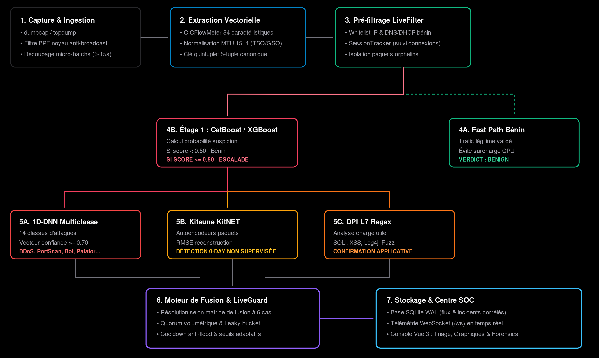

# Architecture Technique — Sentinel NIDS

Sentinel NIDS est un système de détection d'intrusions réseau hybride de niveau entreprise, combinant le filtrage supervisé en cascade, l'apprentissage profond multiclasse, la détection non-supervisée d'anomalies 0-day, l'inspection de contenu applicatif (DPI L7) et un centre de commandement SOC temps réel.

---

## 1. Vue d'Ensemble & Flux de Données

Le schéma ci-dessous illustre le cycle de vie complet d'un paquet réseau, de sa capture brute jusqu'au tableau de bord SOC :

---

## 2. Composants de Détection

### 2.1 Étage 1 — Filtrage Supervisé Binaire (CatBoost & XGBoost)
- **Objectif** : Trier à très haute vitesse les flux réseau normaux du trafic suspect pour soulager les modèles d'inférence lourds.
- **Modèle Principal** : `CatBoostClassifier` entraîné sur 76 caractéristiques CICIDS2017 (`models/stage1_catboost.cbm`).
- **Modèle de Second Avis** : `XGBoost` entraîné sur 30 caractéristiques réduites (`models/stage1_xgboost.json`).
- **Seuil Opérationnel ($t_1$)** : Configurable (défaut : `0.50`). Tout flux avec $score < t_1$ est classé `BENIGN` immédiatement.

### 2.2 Étage 2 — Classification Multiclasse Profonde (DNN-1D PyTorch)
- **Objectif** : Catégoriser avec précision le vecteur d'attaque parmi les familles de menaces connues.
- **Architecture** : Réseau neuronal profond à une dimension (1D-DNN) avec couches de normalisation par lot (`BatchNorm1d`), activation ReLU, MaxPooling et Dropout régulateur (`models/stage2_cnn.pth`).
- **Familles d'Attaques Couvertes (14 classes)** :
  1. `DDoS`
  2. `PortScan`
  3. `Bot`
  4. `Infiltration`
  5. `Web Attack – Brute Force`
  6. `Web Attack – XSS`
  7. `Web Attack – SQL Injection`
  8. `FTP-Patator`
  9. `SSH-Patator`
  10. `DoS slowloris`
  11. `DoS Slowhttptest`
  12. `DoS Hulk`
  13. `DoS GoldenEye`
  14. `Heartbleed`
- **Seuil de Confiance ($t_2$)** : Configurable (défaut : `0.70`).

### 2.3 Branche Parallèle — Détection d'Anomalies 0-Day (Kitsune / KitNET)
- **Objectif** : Détecter les attaques furtives ou inconnues ne correspondant à aucune signature supervisée.
- **Principe** : Ensemble de micro-autoencodeurs neuronaux traitant les flux de caractéristiques amorties dans le temps (fenêtres glissantes 100ms, 500ms, 1.5s, 10s, 1min).
- **Métrique d'Anomalie** : Erreur quadratique moyenne de reconstruction (`RMSE`).
- **Calibration Dynamique Anti-Empoisonnement** :
  - La classe `LiveKitsuneCalibrator` suit en continu l'historique glissant des scores RMSE sur le trafic bénin validé par l'Étage 1.
  - Le seuil $t_3$ s'adapte automatiquement (percentile 99.5%) pour éviter les dérives lentes induites par un attaquant (*adversarial poisoning*).

### 2.4 Inspection de Contenu L7 (DPI Inspector)
- **Objectif** : Analyser la charge utile applicative brute (payload L7) en complément des métriques statistiques de flux.
- **Moteur** : Inspecteur regex multi-règles (`dpi_inspector.py`) opérant directement sur les octets extraits du PCAP.
- **Règles Actives** :
  - `DPI-SQLI` : Détection des motifs SQL (`UNION SELECT`, `' OR 1=1`, `INFORMATION_SCHEMA`).
  - `DPI-XSS` : Détection d'injections de balises et scripts (`<script>`, `javascript:`, `onerror=`).
  - `DPI-RCE-LOG4J` : Détection des chaînes JNDI (`${jndi:ldap:`, `${jndi:rmi:`).
  - `DPI-WEB-FUZZ` : Détection d'outils de fuzzing et scans web (`nikto`, `sqlmap`, `gobuster`, etc.).

---

## 3. Matrice de Décision & Logique de Fusion

| Étage 1 ($t_1$) | Étage 2 ($t_2$) | Kitsune ($t_3$) | DPI Signature | Décision Finale | Sévérité SOC |
|:---:|:---:|:---:|:---:|:---:|:---:|
| Normal (< $t_1$) | *Non exécuté* | Normal (< $t_3$) | Aucune | `BENIGN` | `BENIGN` |
| Normal (< $t_1$) | *Non exécuté* | Anormal ($\ge t_3$) | Aucune | `ANOMALY_UNKNOWN` (0-Day) | `HIGH` |
| Suspect ($\ge t_1$) | Confiant ($\ge t_2$) | Indifférent | Indifférent | **Classe Détectée** (ex: `DDoS`) | `CRITICAL` / `HIGH` |
| Suspect ($\ge t_1$) | Confiant ($\ge t_2$) | Indifférent | Déclenchée | **Attaque DPI** (ex: `Web Attack`) | `CRITICAL` |
| Suspect ($\ge t_1$) | Incertain (< $t_2$) | Normal (< $t_3$) | Aucune | `SUSPECT_UNCERTAIN` | `LOW` |
| Suspect ($\ge t_1$) | Incertain (< $t_2$) | Anormal ($\ge t_3$) | Aucune | `UNKNOWN_ATTACK_LIKELY` | `HIGH` |

---

## 4. Garde Temps Réel & Anti-Flood (`LiveAlertGuard`)

Pour éviter de saturer les analystes du SOC avec des milliers d'alertes redondantes, le module `LiveAlertGuard` applique trois filtres de consolidation :

1. **Déduplication par Cooldown Temporel** :
   - Une alerte pour un couple `(src_ip, attack_type)` ne peut être réémise qu'après expiration d'une fenêtre de cooldown (par défaut 30 secondes).
2. **Quorum Volumétrique Minimum** :
   - Les attaques volumétriques (DDoS, PortScan) nécessitent un volume minimum de flux convergents avant de générer une alerte formelle.
3. **Score de Menace Cumulé (*Leaky Bucket*)** :
   - Chaque adresse IP source accumule un score de risque pondéré par la gravité des événements détectés.
   - Le score décroît exponentiellement dans le temps en l'absence de nouvelle activité malveillante.

---

## 5. Architecture du SOC Command Dashboard

### Backend FastAPI
- **Base de Données Haute Concurrence** : SQLite en mode **WAL** (*Write-Ahead Logging*) avec clés étrangères et indexation composite `(received_at, src_ip, dst_ip)`.
- **Corrélation Automatique d'Incidents** : Regroupement automatique des flux malveillants récurrents dans des incidents consolidés (`incidents`) mis à jour en temps réel.
- **Diffusion Asynchrone WebSocket** : Canal `/ws` assurant la transmission immédiate de chaque micro-batch, des KPI, des séries temporelles et des alertes aux clients connectés.

### Frontend Vue 3 + Tailwind CSS (Obsidian Dark)
- **Thème Strict Obsidian SOC** : Palette zinc sombre (`#09090b`, `#18181b`), police JetBrains Mono `tabular-nums`, zéro emoji, indicateurs d'état colorés normalisés.
- **Composants Principaux** :
  - `TopStatusBar` : Métriques temps réel (FPS de capture, débit, capteurs actifs, mode pause/live).
  - `KpiStrip` : 5 indicateurs clés (total flux, attaques critiques, anomalies 0-day, déclenchements DPI, taux de filtrage).
  - `TrafficTimeline` : Évolution temporelle lissée avec transition cubique (trafic normal vs attaques vs 0-day).
  - `EngineDonut` : Ventilation par moteur de détection (DPI, DNN-1D, Kitsune, Filtrage Rapide).
  - `FlowTriageTable` : Tableau d'analyse temps réel avec pagination, recherche et filtres de sévérité.
  - `ForensicsDrawer` : Panneau d'investigation latérale affichant le 5-tuple, les scores de chaque étage, l'historique IP et **la matrice intégrale des 84 caractéristiques CICFlowMeter** avec recherche instantanée.
