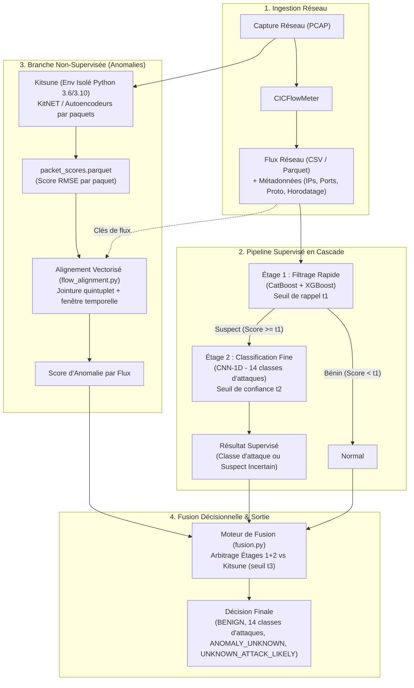
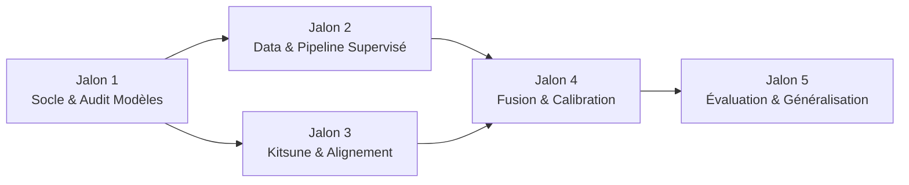
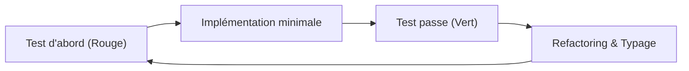

# Plan d'implémentation : Pipeline NIDS Hybride à Deux Étages + Kitsune

Ce document définit la feuille de route technique pour le développement du système de détection d'intrusions réseau (NIDS). Il structure le projet en **5 Jalons (Milestones)** cohérents, séparant clairement les développements locaux légers et les exécutions lourdes sur Google Colab.

---

## 1. Architecture Globale du Système

### Schéma de traitement des flux et paquets



### Modèles référencés

| Rôle | Modèle | Type | Source |
|---|---|---|---|
| **Étage 1 (Binaire - Détecteur)** | NIDS-CatBoost | Supervisé binaire | [pop123ux/pcap-ml-traffic-classifier](https://huggingface.co/pop123ux/pcap-ml-traffic-classifier) |
| **Étage 1 (Second avis)** | NIDS-XGBoost (AegisAI) | Supervisé binaire | [csperera/aegis-ai](https://github.com/csperera/aegis-ai) |
| **Étage 2 (14 classes)** | `cnn1d_attacks_only.pth` + `scaler.pkl` | Supervisé multiclasse | [saidimn/ids-cnn-cicids2017](https://huggingface.co/saidimn/ids-cnn-cicids2017) |
| **Détection d'anomalies** | Kitsune (AfterImage + KitNET) | Non-supervisé en ligne | [ymirsky/Kitsune-py](https://github.com/ymirsky/Kitsune-py) |

---

## 2. Organisation du Dépôt & Environnements

```
nids-pipeline/
├── configs/
│   ├── model_specs.yaml            # Schémas des entrées et métadonnées des modèles (rempli au Jalon 1)
│   ├── col_mapping_2018.yaml       # Normalisation CSE-CIC-IDS2018 -> CICIDS2017
│   └── thresholds.yaml             # Seuils opérationnels (t1, t2, t3) et fenêtres temporelles
├── envs/
│   ├── main.txt                    # Dépendances principales (PyTorch, CatBoost, XGBoost, Pandas, PyArrow)
│   └── kitsune.txt                 # Environnement isolé dédié à Kitsune (Scapy, compatibilité NumPy)
├── notebooks/                      # Exécutions déportées sur Google Colab (calcul lourd)
│   ├── colab_phase2_data_prep.ipynb    # Nettoyage et split complet (.parquet)
│   ├── colab_phase7_kitsune_run.ipynb  # Exécution massive de Kitsune sur gros PCAP
│   └── colab_phase10_11_eval.ipynb     # Calibration et benchmark complet
├── src/nids/
│   ├── __init__.py
│   ├── labels.py                   # Définition canonique des étiquettes et constantes
│   ├── features.py                 # Normalisation et alignement strict des colonnes
│   ├── adapters/                   # Adaptateurs uniformes pour chaque modèle
│   │   ├── base.py                 # Protocoles Stage1Model et Stage2Model
│   │   ├── stage1.py               # Implémentations CatBoost & XGBoost
│   │   └── stage2.py               # Implémentation CNN-1D PyTorch
│   ├── pipeline.py                 # Orchestrateur en cascade Étages 1 & 2
│   ├── kitsune_runner.py           # Pilote d'inférence Kitsune (dans son sous-environnement)
│   ├── flow_alignment.py           # Jointure vectorisée paquets ↔ flux
│   ├── fusion.py                   # Matrice de décision et fusion des scores
│   ├── thresholds.py               # Fonctions d'étalonnage des seuils (t1, t2, t3)
│   └── evaluate.py                 # Calcul des métriques, matrices de confusion et F1-scores
├── tests/
│   ├── unit/                       # Tests unitaires rapides (sans vrais modèles)
│   ├── integration/                # Tests avec modèles réels sur mini-échantillons
│   └── e2e/                        # Test du pipeline complet de bout en bout
├── data/
│   ├── samples/                    # mini.csv (200 lignes) et mini.pcap (5 000 paquets) versionnés
│   ├── raw/                        # Datasets complets bruts (exclus de Git)
│   └── processed/                  # Splits .parquet intermédiaires (exclus de Git)
├── models/                         # Poids téléchargés (exclus de Git)
├── Makefile                        # Commandes standard (install, lint, test, test-all)
├── pyproject.toml
└── README.md
```

### Répartition de l'exécution : Local vs Google Colab

| Composante | Environnement | Données utilisées | Objectif |
|---|---|---|---|
| **Développement & TDD** | **Local (Antigravity / VS Code)** | `mini.csv` (200 lignes)<br>`mini.pcap` (5 000 paquets) | Développement modulaire, tests unitaires et intégration rapides. |
| **Préparation des données** | **Google Colab** | `GeneratedLabelledFlows.zip` (CICIDS2017)<br>`CSE-CIC-IDS2018` | Nettoyage volumineux, conversions et splits exportés en `.parquet`. |
| **Inférence Kitsune lourde** | **Google Colab** | PCAPs volumineux (Lundi bénin + attaques) | Extraction AfterImage et calcul des scores RMSE sans saturer la machine locale. |
| **Calibration & Benchmark** | **Google Colab** | Splits complets `val.parquet`, `test.parquet`, `test_2018.parquet` | Balayage des seuils, évaluation globale et calcul de la dérive conceptuelle. |

---

## 3. Jalons d'Implémentation (Milestones)



---

### Jalon 1 — Socle, Environnements & Audit Sécurisé des Modèles

> **Objectif :** Poser les bases du dépôt, outiller la CI/qualité locale, télécharger les modèles pré-entraînés et réaliser leur rétro-ingénierie sécurisée sans exécution de code non vérifié.

#### Actions & Livrables
1. **Initialisation du projet :**
   - Configurer `pyproject.toml`, `.gitignore`, `Makefile` (cibles : `install`, `lint`, `test`, `test-all`).
   - Définir `envs/main.txt` (Python 3.10+, PyTorch, CatBoost, XGBoost, Pandas, PyArrow, Pytest) et `envs/kitsune.txt`.
2. **Audit & Inspection Statique des Modèles :**
   - Télécharger les poids dans `models/` (exclus de Git).
   - **Règle de sécurité :** Ne lancer aucun `pickle.load()` aveugle. Inspecter la structure via `pickletools.dis()`, `h5py`, ou `torch.load(..., weights_only=True)`.
   - Intégrer le XGBoost de `csperera/aegis-ai` (`xgb_model.json`, `feature_names.json`, `scaler.pkl`) comme second avis validé sur CICIDS2017.
   - Analyser le CNN-1D de `saidimn` : vérifier la structure du réseau (reconstruire le `nn.Module` si seul le `state_dict` est présent) et documenter l'ordre exact des 14 classes.
3. **Spécification formelle :**
   - Figer la configuration dans `configs/model_specs.yaml` (chemins, types, liste ordonnée des variables d'entrée par modèle).

#### Critères de validation (DoD)
- `make test` passe (test smoke d'importation).
- `configs/model_specs.yaml` est complété sans ambiguïté.
- Aucune zone d'ombre bloquante sur le format ou les features attendues des modèles.

---

### Jalon 2 — Données & Pipeline Supervisé en Cascade (Étages 1 & 2)

> **Objectif :** Préparer les données en préservant le contexte réseau, standardiser les interfaces d'inférence, et assembler le pipeline supervisé en cascade.

#### Actions & Livrables
1. **Préparation & Échantillonnage des Données :**
   - Créer `src/nids/labels.py` (constantes canoniques des attaques et labels autorisés).
   - Développer la logique de nettoyage, déduplication et découpage stratifié (graine 42).
   - **Conservation des métadonnées réseau :** Garder impérativement `Flow ID`, `Source IP`, `Destination IP`, `Source Port`, `Destination Port`, `Protocol` et `Timestamp` (requis pour la fusion ultérieure avec Kitsune).
   - Générer `data/samples/mini.csv` (~200 lignes représentatives).
   - Écrire `notebooks/colab_phase2_data_prep.ipynb` pour produire les splits `.parquet` complets sur Colab.
2. **Module d'alignement (`src/nids/features.py`) :**
   - Implémenter `align(df: pd.DataFrame, expected: list[str]) -> pd.DataFrame` :
     - Écarte automatiquement les métadonnées réseau lors de l'inférence ML.
     - Nettoie les noms de colonnes (`strip()`), réordonne strictement selon `expected`.
     - Gère les `inf` et `NaN`, garantit l'immutabilité du DataFrame d'entrée.
3. **Adaptateurs Modèles (`src/nids/adapters/`) :**
   - Définir les protocoles `Stage1Model` (méthode `score(df) -> np.ndarray`) et `Stage2Model` (méthode `predict_proba(df) -> np.ndarray`).
   - Implémenter `CatBoostStage1` et `XGBoostStage1`.
   - Implémenter `CnnStage2` (gestion du scaler, reshape PyTorch `(n, 1, features)` ou `(n, features, 1)`, mode `eval()`, vérification de l'ordre des classes).
4. **Pipeline en Cascade (`src/nids/pipeline.py`) :**
   - Étage 1 : `score = max(modèles_actifs)`. Si `score < t1` $\rightarrow$ `BENIGN`.
   - Étage 2 : Invoqué **uniquement** sur les flux suspects ($score \ge t1$). Si $\max(proba) < t2$ $\rightarrow$ `SUSPECT_UNCERTAIN`, sinon classe majoritaire.

#### Critères de validation (DoD)
- Tests unitaires et d'intégration verts sur `mini.csv`.
- Preuve que l'Étage 2 n'est jamais sollicité si tous les flux sont bénins.
- Somme des probabilités de l'Étage 2 égale à 1.0 (tolérance $10^{-5}$).

---

### Jalon 3 — Branche Non-Supervisée & Alignement Vectorisé (Kitsune)

> **Objectif :** Intégrer la détection d'anomalies au niveau paquet (Kitsune) et corréler efficacement les scores paquets avec les flux réseau.

#### Actions & Livrables
1. **Intégration Kitsune en Environnement Isolé :**
   - Isoler les dépendances historiques dans `envs/kitsune.txt`.
   - Implémenter `src/nids/kitsune_runner.py` capable d'apprendre sur une capture bénigne et d'inférer sur un PCAP cible.
   - Identifier et marquer explicitement les périodes de grâce (`FMgrace`, `ADgrace`) afin de les exclure des calculs métriques.
   - Prévoir l'alternative technique documentée (Plan B : `KitNET-py` direct) si l'extraction Scapy/AfterImage pose un blocage système.
   - Produire `notebooks/colab_phase7_kitsune_run.ipynb` pour l'inférence lourde sur Colab.
2. **Alignement Vectorisé Paquets $\leftrightarrow$ Flux (`src/nids/flow_alignment.py`) :**
   - Implémenter `aggregate_scores(flows: pd.DataFrame, packets: pd.DataFrame, rule: str = "max") -> pd.Series`.
   - **Contrainte stricte de performance :** Interdiction des boucles `for` Python sur les paquets/flux.
   - Calculer une clé de quintuplet canonique bidirectionnelle :
     $$\min(\text{IP}_A:\text{Port}_A, \text{IP}_B:\text{Port}_B) \;\|\; \max(\text{IP}_A:\text{Port}_A, \text{IP}_B:\text{Port}_B) \;\|\; \text{Protocol}$$
   - Effectuer un `merge` vectorisé et filtrer selon la fenêtre $[Timestamp_{début} - \Delta t, Timestamp_{fin} + \Delta t]$.
   - Agréger les scores d'anomalie (`max` ou `top_k_mean`). Renvoyer `NaN` pour les flux sans paquet associé.

#### Critères de validation (DoD)
- Test d'alignement vectorisé validé sur `mini.pcap` et `mini.csv`.
- Prise en compte bidirectionnelle vérifiée (paquets Aller et Retour rattachés au même flux).
- Absence de fuite temporelle (les paquets hors fenêtre sont ignorés).

---

### Jalon 4 — Fusion Décisionnelle & Calibration sans Fuite

> **Objectif :** Définir la table de décision finale et calibrer les seuils de manière scientifiquement rigoureuse sur le jeu de validation.

#### Actions & Livrables
1. **Moteur de Fusion (`src/nids/fusion.py`) :**
   - Implémenter la logique d'arbitrage selon la matrice ci-dessous :

| Étage 1 ($t_1$) | Étage 2 ($t_2$) | Kitsune ($t_3$) | Étiquette Finale | Signification métier |
|---|---|---|---|---|
| **Normal** (< $t_1$) | *Non exécuté* | **Normal** (< $t_3$) | `BENIGN` | Trafic régulier validé |
| **Normal** (< $t_1$) | *Non exécuté* | **Anormal** ($\ge t_3$) | `ANOMALY_UNKNOWN` | Attaque potentielle inconnue / 0-day |
| **Suspect** ($\ge t_1$) | **Confiant** ($\ge t_2$) | *Indifférent* | **Nom de l'attaque** | Attaque connue identifiée (14 classes) |
| **Suspect** ($\ge t_1$) | **Incertain** (< $t_2$) | **Normal** (< $t_3$) | `SUSPECT_UNCERTAIN` | Anomalie légère non confirmée |
| **Suspect** ($\ge t_1$) | **Incertain** (< $t_2$) | **Anormal** ($\ge t_3$) | `UNKNOWN_ATTACK_LIKELY` | Forte suspicion d'attaque non répertoriée |
| *Indifférent* | *Indifférent* | `NaN` (absent) | Décision Étages 1+2 | Repli automatique (fallback flux seul) |

2. **Étalonnage des Seuils (`src/nids/thresholds.py`) :**
   - **Règle absolue :** Calibration exclusive sur `val.parquet`, interdiction stricte de toucher au jeu de test.
   - Seuil $t_1$ : Balayage pour garantir un rappel cible minimal (ex: Rappel $\ge 0.98$ sur les attaques).
   - Seuil $t_2$ : Optimisation du compromis F1-score / taux de `SUSPECT_UNCERTAIN`.
   - Seuil $t_3$ : Fixé au $99^e$ percentile des scores Kitsune sur trafic bénin de validation.
   - Enregistrement des valeurs obtenues dans `configs/thresholds.yaml`.

#### Critères de validation (DoD)
- Tous les cas de la matrice de fusion sont couverts par des tests unitaires paramétrés.
- Le module de calibration refuse explicitement de s'exécuter si un fichier de test lui est passé en entrée.

---

### Jalon 5 — Évaluation Expérimentale, Généralisation & Démo

> **Objectif :** Évaluer les performances globales, mesurer la résistance au changement de domaine (généralisation), et livrer un outil de démonstration exécutable.

#### Actions & Livrables
1. **Évaluation Globale (`src/nids/evaluate.py`) :**
   - Évaluer sur `test.parquet` (utilisé **une seule fois**) et comparer 3 configurations :
     1. Supervisé seul (Étages 1 + 2)
     2. Non-supervisé seul (Kitsune)
     3. Pipeline hybride complet
   - Rapporter : Rappel et FPR Étage 1, F1-score macro et pondéré par classe Étage 2, matrices de confusion.
   - Mesurer la valeur ajoutée de Kitsune (attaques ratées par l'Étage 1 mais interceptées par Kitsune).
2. **Généralisation Inter-Datasets (Mesure de dérive conceptuelle) :**
   - Appliquer `configs/col_mapping_2018.yaml` pour mapper `CSE-CIC-IDS2018` vers le schéma attendu.
   - Évaluer le pipeline sans aucun ré-entraînement sur `CSE-CIC-IDS2018`.
   - Quantifier l'impact du *domain shift* réseau (résultat scientifique central).
3. **Script Démo & Clôture :**
   - Implémenter `scripts/run_demo.py` :
     ```bash
     python scripts/run_demo.py data/samples/mini.csv --packets data/samples/packet_scores.parquet
     ```
   - Rédiger le `README.md` final (instructions d'installation, guide de reproduction Colab, résultats de détection et licences).

#### Critères de validation (DoD)
- `make test-all` entièrement vert.
- Le script `run_demo.py` s'exécute de bout en bout sans erreur.
- Rapport comparatif documenté entre `CICIDS2017` et `CSE-CIC-IDS2018`.

---

## 4. Stratégie de Test & Assurance Qualité (TDD)

Le projet applique une démarche **Test-Driven Development (TDD)** : chaque test unitaire est écrit avant la fonction associée.



### Pyramide de tests et marqueurs Pytest

| Type de Test | Cible | Modèles réels ? | Marqueur Pytest | Commande |
|---|---|---|---|---|
| **Unitaire** | Fonctions isolées, calculs mathématiques, cas limites | Non (données factices / mocks) | *(aucun)* | `make test` |
| **Intégration** | Adaptateurs, alignement, fusion | Oui (sur `mini.csv`) | `requires_models` | `make test-all` |
| **Kitsune** | Détecteur d'anomalies en sous-processus | Oui (sur `mini.pcap`) | `requires_kitsune` | `make test-all` |
| **End-to-End (E2E)** | Chaîne complète CSV + PCAP | Oui | `e2e` | `make test-all` |

**Règles transversales vérifiées par test :** Déterminisme (graine 42), gestion d'un lot vide, lot d'une seule ligne, et immutabilité stricte des DataFrames d'entrée.

---

## 5. Matrice des Risques Techniques & Parades

| Risque identifié | Impact | Stratégie d'atténuation / Parade |
|---|---|---|
| **Exécution de code arbitraire (`pickle.load`)** | Critique (Sécurité) | Inspection statique obligatoire (`pickletools.dis()`, `weights_only=True`, `h5py`) au Jalon 1 avant tout chargement. |
| **Inversion de classes dans le CNN-1D** | Critique (Décision) | Vérification de l'ordre exact du vecteur de sortie dès l'audit et test unitaire dédié liant le nom au bon indice. |
| **Absence d'IPs/Timestamps dans les CSV publics** | Élevé (Blocage fusion) | Utilisation obligatoire de l'archive `TrafficLabelling` (`GeneratedLabelledFlows.zip`) de CICIDS2017, jamais `MachineLearningCSV.zip`. |
| **Lenteur de l'alignement paquets ↔ flux** | Élevé (Performance) | Conception 100 % vectorisée sous Pandas (`merge` sur quintuplet canonique bidirectionnel ordonné + filtre temporel). |
| **Dépendances obsolètes de Kitsune** | Moyen (Compatibilité) | Isolement complet dans `envs/kitsune.txt`, exécution en sous-processus découplé via fichiers Parquet intermédiaires (Plan B : `KitNET-py`). |
| **Saturation mémoire RAM en local** | Moyen (Stabilité) | Développement et tests locaux exclusivement limités à `mini.csv`/`mini.pcap`. Déport systématique des volumes complets sur Google Colab. |
| **Dégradation sur CSE-CIC-IDS2018** | Faible (Scientifique) | Phénomène normal de dérive conceptuelle (*domain shift*), analysé et documenté comme résultat comparatif au Jalon 5. |
